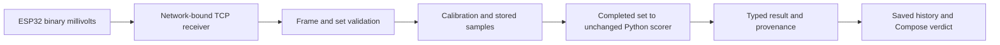

# Android receive and scoring pipeline

## Result and scope

**Measured:** synthetic ESP32 packets pass over loopback through the production TCP receiver, binary parser, calibration, recorder, archive replay, unchanged Python scorer and result conversion. The check then saves and reloads the verdict and history. It runs the actual scorer and storage code.

**Needs hardware:** Android Wi-Fi association, network callbacks, permissions, foreground recording, Chaquopy on the phone and the rendered verdict still need testing. This review did not build or run an APK.

The transport authority remains [ESP32-WIRE-V1.md](ESP32-WIRE-V1.md), with implementation guidance in [FIRMWARE-HANDOFF.md](FIRMWARE-HANDOFF.md). No packet format, firmware command or validated Python arithmetic was changed.

## How the app connects and receives data

**Documented — wire specification and `WifiJoiner.kt`, `DeviceLink.kt`:** the ESP32 advertises a WPA2 access point named `Tally-<last MAC bytes>`. The user supplies its provisioned password; no default password is invented. The phone uses `WifiNetworkSpecifier` to request a matching network and connects its network-bound socket to `192.168.4.1:5198`. Only that socket uses the selected Wi-Fi network; the app does not bind the whole process or request Internet capability from the ESP32.

**Documented — app manifest and `rememberConnect` in `TallyApp.kt`:** Android API 33 and later request Nearby Wi-Fi Devices permission; earlier supported versions request fine location. The backend reports disabled Wi-Fi clearly, and below that API boundary also checks whether Location services are enabled. Android may ask the user to approve the matching access point. These choices follow the [Android network request API](https://developer.android.com/develop/connectivity/wifi/wifi-bootstrap) and [Wi-Fi permission guidance](https://developer.android.com/develop/connectivity/wifi/wifi-permissions); the older discovery preflight follows the [Location requirement for Wi-Fi scanning](https://developer.android.com/develop/connectivity/wifi/wifi-scan).

The app reports **Connected** after the TCP receiver receives and validates `HELLO`. It reports errors for a wrong password, declined selection, unavailable access point, failed TCP connection or missing/incompatible handshake.

**Documented — `FrameCodec.kt` and the frozen wire specification:**

| Item | Required information |
|---|---|
| Frame envelope | `TY` magic, version `1`, message type, little-endian payload length, payload, IEEE CRC32 over version through payload |
| Payload limit | At most `512` bytes |
| Initial `HELLO` | Firmware version, MAC, reset reason, sampling period `10000` microseconds, `6` channels, attenuation code, set capacity `60000`, ring capacity `3000`, active set and next sequence |
| `SET_STARTED` | The requested nonzero set ID and selected `L` or `R` side |
| `SAMPLES` | Set ID, first sequence, count `1..10`, then each sample's ESP32 microsecond timestamp and `6` unsigned millivolt values |
| `SET_END` | Set ID, reason and final sample count |
| `HEARTBEAT` | Uptime, ring fill and minimum free heap; it proves link activity, not sensor reception |

**Documented — channel order in the wire specification:** upper-arm x/y/z on GPIO36/39/34, then forearm x/y/z on GPIO35/32/33. These are raw calibrated ADC millivolts, not raw ADC counts, g values, CSV lines or model verdicts.

TCP reads do not correspond to packets. `DeviceLink` buffers incomplete frames and decodes multiple frames from a single read. It rejects corrupt CRCs, malformed framing, repeated `HELLO`, phone commands sent by the device and truncated EOF. It never repairs or skips malformed bytes.

## From readings to the user's verdict



**Documented — `SetRecorder.kt`, `Calibration.kt`, `TallyWireWriter.kt`:** the recorder requires matching set IDs and side, contiguous sequence numbers, strictly increasing timestamps and consistent final sample counts. A gap beyond `15000` microseconds, an implausible voltage above `3300` millivolts or capacity overflow fails validation. Timestamps must also remain strictly increasing after conversion to milliseconds for the scorer. A bad sample frame is rejected before any of its samples are committed.

Nominal calibration uses documented conversion constants; recorded readings still come from the sensors. Saved pose calibration supplies channel offsets and scales. The recorder converts millivolts to g and preserves raw frames for recovery/export. Corrupt stored calibration is refused, not silently used.

The phone builds an internal `#TALLY2` text record from the calibrated samples. This text is an internal scoring input, not a new firmware protocol. After the set ends, the single scorer worker calls the existing `tally_app.score_wire` bridge and validated standard-library Python runtime. There is no live model inference or live rep count.

`ScoredResult.kt` is now the shared conversion used by both the Android backend and the host integration check. It preserves unknown/null verdicts for rejected or insufficient sets. Valid scored results carry estimated set and rep verdicts, probability, exercise, diagnostics and provenance. `SetRepository` saves the result and exposes history; `ResultScreen` presents it through the contract. Python's text reply is not sent back to the ESP32: the firmware wire contract defines only the existing binary control commands.

## Reliability changes made in this review

- Track the currently available Android Wi-Fi network and clear lost handles. Reconnect uses the current network or requests a fresh one, with a bounded recovery deadline.
- Refresh `HELLO` on successful reconnect. During an active set, require the same MAC and set ID and refuse a device sequence behind the phone. Idle reconnection refreshes firmware/reset provenance too.
- Watch sample progress independently of heartbeat traffic. A responsive device that never sends samples no longer leaves recording looking healthy indefinitely. The recording screen shows the connection reason.
- Reject timestamps that would become duplicates in the scorer's millisecond input. Valid sets starting at timestamp zero remain accepted.
- Enforce the same calibration bounds when loading saved data as when capturing it. Keep unfinished calibration progress out of saved UI state, because the unsaved measurements themselves do not survive process death.
- Use the existing model installer's atomic file-move pattern for replacing metadata and results. The host integration test exposed that `File.renameTo` could not replace an existing metadata file on Windows; repeated metadata/result replacement is now checked.

**Documented — `DeviceLink.kt`, `SampleProgress.kt`, `AndroidTallyBackend.kt`:** the link silence/sample progress threshold is `3` seconds. The recording monitor checks progress every `1` second, so this is a watchdog threshold rather than an exact phone scheduling guarantee. Recovery remains within the documented `30`-second ring window and requests `RESUME` from the next missing sample. Missing samples are never synthesized. An unrecoverable set stops; an eligible contiguous prefix can be scored only by explicit user choice and is labelled partial.

The raw attenuation code is now retained in set metadata alongside reset information. The wire document does not assign a numeric attenuation encoding, so this review does not invent a new numeric firmware rejection rule.

## Executed checks and evidence

Run from the repository root:

```powershell
py -B backend/tools/pipeline_checks.py
```

The runner uses existing cached Kotlin/JVM dependencies and an Android API jar for signature compilation only. It does not install an SDK or run Android APIs. It needs the existing host-check JSON library either in the Gradle cache or at `backend/build/host-check-deps/json-20160810.jar`. Each run writes a fresh artifact directory; `backend/build/pipeline-checks/latest.json` points to the most recent successful run's manifest and results. Build artifacts are ignored by Git.

**Measured — that command, successful artifact directory `backend/build/pipeline-checks/run-1794869859069616500`:**

| Check | Result |
|---|---|
| JVM unit checks | `24` passed, including loopback reception, malformed traffic, silence timeout, sample progress, result mapping, calibration, fake mode and copy/import boundaries |
| Assert-based checks | Frame codec, storage/CSV, recorder, archive replay, sample limits, atomic replacement and malformed-frame rejection passed |
| Python bridge checks | `5` passed, including Kotlin-calibrated input, model/scorer hashes and invalid set rejection; no skipped checks |
| Full host capture | Both sides received `60000` synthetic samples through the production TCP receiver and recorder, then ran the actual scorer and persisted/reloaded the typed result and history |
| Left fixture result | Status `scored`, timestamp-derived rate `100.0 Hz`, estimated verdict `correct`, mean p(wrong) `0.040125`, class `SQZ` |
| Right fixture result | Status `scored`, timestamp-derived rate `100.0 Hz`, estimated verdict `correct`, mean p(wrong) `0.005995`, class `SQZ` |

**Derived — `PipelineChecks.kt`:** each fixture represents `600` seconds at the documented `100 Hz`. The sender transmits faster than real time. This exercises the maximum sample/archive size; it is not a real-time radio soak test. Its normal completion at that size is a host boundary fixture, not evidence that real firmware should bypass its documented overflow behavior. The synthetic verdicts have no ground-truth exercise or clinical accuracy meaning.

**Measured — successful run's `manifest.json` and stored result files:**

| Provenance | Value |
|---|---|
| Left model SHA256 | `334111ce74e5c3f4ba0c24d0a5f9d27263ddae802ea275eab3903d45b247089c` |
| Right model SHA256 | `a3a5d43c7be7dcdd94bd33a2b2969577d16fbf62605987d1ec9f84646d1d1fed` |
| Scorer SHA256 | `3c7af82589ee5832fe180e2abfbf2fc4cb55806a47d86e8292903d97c459244c` |
| Git revision | `23234e1f4dd81ae70e53c2f32c62fa9aa7c69d7d-dirty`; reviewed changes are uncommitted |
| Test sender | Firmware value `42`, MAC `02:00:00:00:00:42`; these came from the synthetic `HELLO`, not physical hardware |
| Calibration | Per-run `six-pose-<timestamp>` ID, stored with offsets/scales in each set's metadata |
| App version marker | `1.0-host-check`, explicitly not an APK execution |

The manifest records the actual cached tool paths. This run used Java `17.0.19`, Kotlin compiler `2.4.20` and coroutines `1.8.0` (**measured**, manifest), rather than the Android project's complete Gradle toolchain. Android lifecycle orchestration, the factory, foreground service and Chaquopy worker are excluded from host compilation/execution; they received source review. The loopback harness explicitly assembles their data-path steps, so it cannot prove that Android invokes those steps correctly at runtime.

## What still needs a phone and ESP32

| Hardware check | Expected behavior |
|---|---|
| Correct/incorrect password, permission acceptance/denial, disabled Wi-Fi | Clear success/error; Connected only after a compatible device handshake |
| Real sensor movement and still poses | Sample count and trace advance; channel order, supply range, timing and calibration agree with the actual boards |
| Stop a real set | Scoring completes on the phone and the saved result includes actual firmware, MAC, model/scorer hashes and calibration ID |
| Lose and restore Wi-Fi | Rejoin the actual network, verify the same active device/set and resume without missing or duplicate samples; show failure/partial choice when recovery cannot succeed |
| Background, rotation and process termination | Foreground service/locks and archive recovery behave correctly; no false calibration progress or invented complete set |
| Actual installed app | APK packaging, ARM runtime, Chaquopy binding, UI verdict rendering and Android CSV sharing all work |

**Documented — `app/build.gradle.kts`:** the current target SDK is `36`. Raising it to `37` or higher requires revisiting the new local-network runtime permission under [Android's local-network permission rules](https://developer.android.com/privacy-and-security/local-network-permission). That target change is outside this review.
