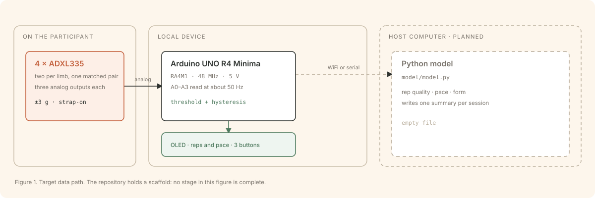

# ECE 198: Home Exercise Monitoring

Sensors for older adults who exercise at home alone. The device counts repetitions and keeps the pace honest.

<picture>
  <source media="(prefers-color-scheme: dark)" srcset="https://raw.githubusercontent.com/Peteryhs/198-Project/main/assets/data-flow-dark.svg">
  
</picture>

## What the project does

CCCARE (Centre for Community, Clinical and Applied Research Excellence) runs supervised exercise programs for older adults at the University of Waterloo. One instructor supervises up to 30 participants in one session. When a participant goes home, no one measures the exercises.

This project measures those exercises. Four accelerometers sit on one pair of limbs. An Arduino UNO R4 Minima reads the sensors, counts each repetition, and shows the count and the pace on a small screen. A Python model on a host computer scores the quality of the session and writes a summary for the instructor.

## Status

The repository holds a scaffold. No part of the system runs yet.

| Part | State |
| --- | --- |
| `hardware/198project/` | Sketch entry point and an `Accelerometer` class header. The sketch is a stub. |
| `model/model.py` | Empty file. |
| Data transfer | Not started. `data_transfer.h` and `data_transfer.cpp` are placeholders. |
| WiFi path | Under evaluation with the Arduino Yún shield. |
| Bill of materials | Drafted. No parts are ordered. |

## How it works

The UNO R4 Minima has six analog inputs. The design uses four of them, one for each sensor, on pins A0 to A3. Two inputs stay free.

Two sensors on one limb measure the angle between its segments. One sensor on a limb shows only that the limb moved. The pair is the reason the device can tell a full repetition from a shallow one.
