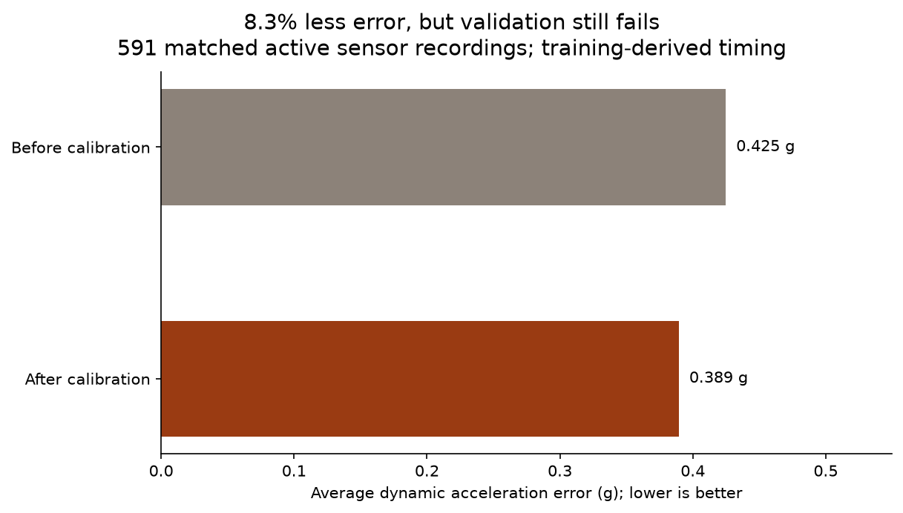
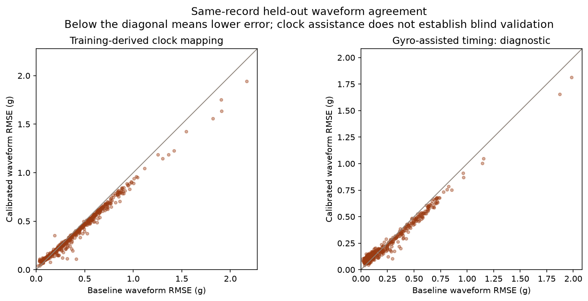
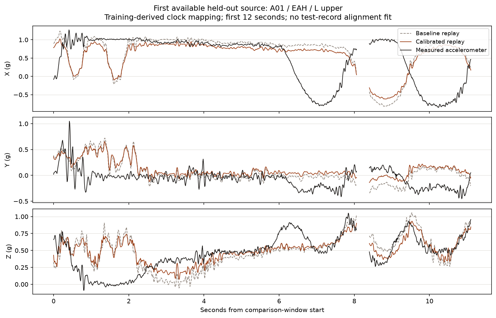
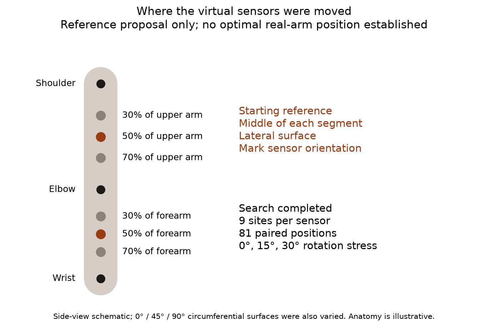
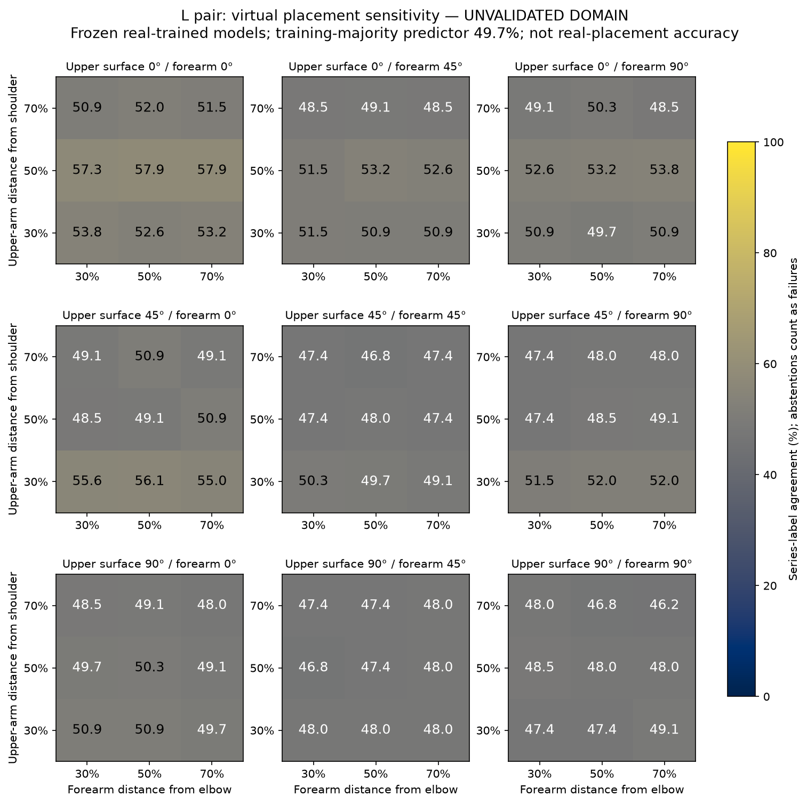
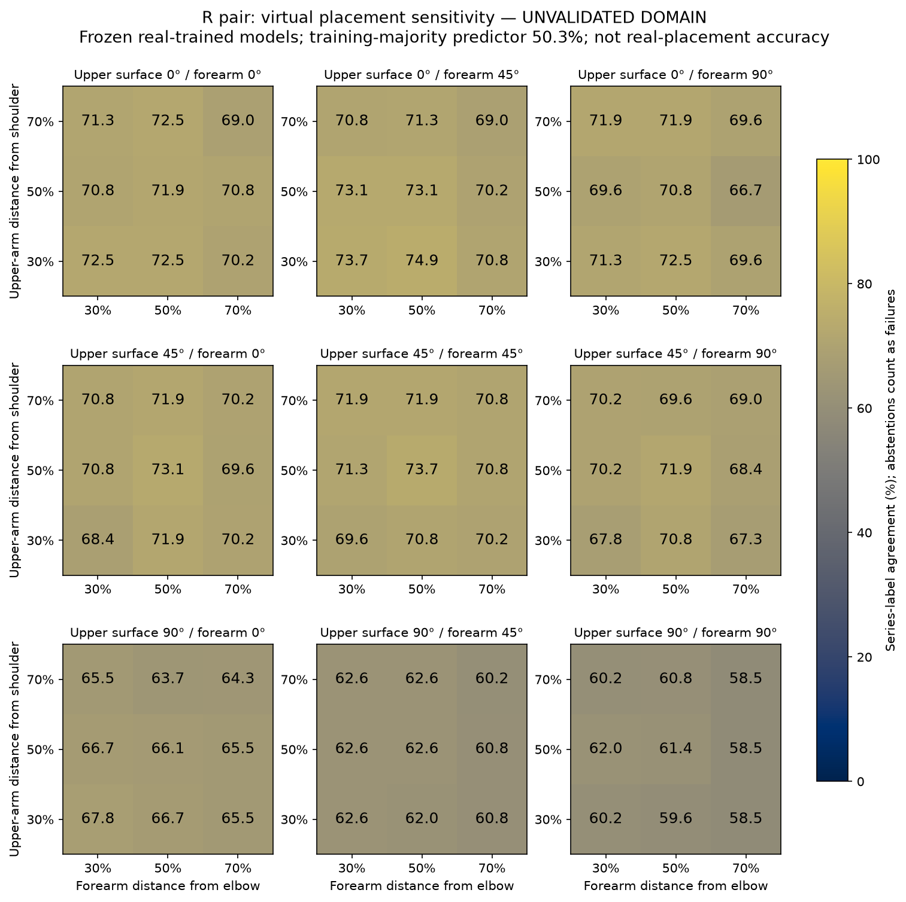

# Tally: calibrated replay and virtual sensor search

**Historical results:** [Phase 5](PHASE5-REPORT.md) found and corrected a sparse fit/scoring
interpolation mismatch and reran calibration separately. The failed-validation conclusion remains.
This report and the original placement curves are preserved; see Phase 5 for corrected numbers.

2026-11-07. Base `50cec19`; branch `codex/simulator-calibration-search`. Computer-only work;
no physical board, push, PR, firmware change or accepted-model replacement.

## What we learned, in plain language

We can now replay measured arm-board motion, move two virtual accelerometers independently,
and run their signals through held-out versions of the existing model. We also expanded the
optical reference from a five-person local subset to **all 30 volunteers in the original study**.
No new participants or hardware recordings were required.

The new calibration reduces average dynamic acceleration error **8.3%, from 0.425 g to 0.389 g**,
on the same 591 active held-out sensor recordings. This is a limited improvement in one metric,
not an 8.3-point increase in classification accuracy. The simulator **still fails validation**.
It is useful for checking physics and exploring model sensitivity; it cannot yet tell us the
most accurate real-arm mounting position.



The original hand-driven MuJoCo two-link simulation remains unchanged. Its historical signal
comparison failed 0/84 checks. This phase adds a separate measured-motion replay with a bounded,
training-only physical calibration. We did not relax the old threshold or replace its historical
failure with a score from a different cohort.

## What changed

1. Audited and CRC/size-verified 402 published optical files: 171 raw exercise trials, their 171
   interpolated counterparts and 30 calibration takes in each representation. Fixed A3/A03 identity
   matching while retaining exact source paths. Found 92 exports with nonzero frame/time origins.
2. Added virtual sensor physics at an actual displaced point, including gravity, board rotation,
   sensor orientation, chip-origin offset and gain/bias. Missing spans and differentiation edges
   remain unavailable. Changing the surface moves the point and rotates its axes.
3. Fitted four shared physical sensor calibrations in each of 30 leave-one-person-out folds.
   The held-out volunteer supplies neither fit parameters nor the primary clock mapping.
4. Tested functional shoulder/elbow constraints using the published calibration poses. This
   describes possible anatomy; it does not substitute inferred landmarks into held-out fits.
5. Completed the coarse position/model experiment and retained every source-level decision,
   coverage figure, rejection and remount scenario. Results are explicitly diagnostic because
   original-site validation failed. No replacement model was trained on failed-domain simulation.

The earlier augmentation pipeline, local visual inspector and conservative feedback groundwork
remain available in [Phase 3](PHASE3-REPORT.md). This phase adds numerical evidence and static
inspection plots; it does not quietly change those earlier experiments.

## How much better is the simulator?

The waveform experiment has 653 accepted sensor-records from 30 people; 31 of 684 potential pairs
were rejected for non-finite or nonmonotonic inertial data. A sensor-record is one board in one
trial, not a new participant. The primary comparison has 611 usable matched overlaps, including
591 with measured dynamic RMS at least 0.05 g. Baseline and calibrated versions use identical
samples and time grids within each comparison.

| Original-site held-out measure | Baseline | Calibrated | Interpretation |
| --- | ---: | ---: | --- |
| Mean dynamic RMSE, 591 active records | 0.4246 g | 0.3893 g | 8.32% reduction; below declared 10% improvement requirement |
| Median total RMSE, all 611 matched records | 0.3841 g | 0.3595 g | 6.39% reduction; different summary from the active mean above |
| Median active dynamic correlation | — | 0.120 | Required ≥0.70; failed |
| Median active dynamic normalized RMSE | — | 1.195 | Required ≤0.50; failed |
| Maximum absolute axis bias, matched records | — | 0.902 g | Required ≤0.10 g; failed |
| P95 discrepancy of training clock versus per-record gyro lag estimates | — | 67.69 s | Required ≤0.01 s; failed; gyro matching is itself ambiguous |
| Shared transform design rank | — | 120/120 rank 12 | Numerical identifiability screen passed; 58 fits touched a bound |

A deterministic 2,000-resample participant bootstrap gives 7.72–8.93% for the primary dynamic-error
reduction. It describes variability across these volunteers under this timing policy; it does not
account for systematic clock/model errors or establish physical fidelity. The 67.69-second number
is a disagreement between lag estimators, **not independently measured clock error**. Matching
similar cyclic motion can be ambiguous; a training-population median does not synchronize a new take.

The separate reference-assisted diagnostic uses each held-out recording's gyro to align it.
That information is never used for the primary score or fit. On its own 571 matched comparisons,
median total RMSE **worsens from 0.1087 g to 0.1342 g** after calibration. Its 380 active records
show a 4.35% mean dynamic-error reduction. These are different cohorts/timing policies and cannot
be presented as a matched gain over the primary track. Even among the 344 comparisons satisfying
the predeclared gyro correlation/margin screen, median total error worsens from 0.1047 g to
0.1306 g. The fit has not demonstrated a reliable transferable board-to-chip correction.





The example is the lexicographically first available primary waveform cache, not a favorable
selection. Broken lines preserve missing spans. The legacy distribution thresholds remain
unchanged (median ratios 0.75–1.33, normalized Wasserstein ≤0.5); they were **not rerun as a new
pass count** after the earlier timing/waveform gate failed. No improved spectrum, cycle-timing,
envelope or original-site distribution pass is claimed.

## Where should the physical sensors go?

**Use lateral mid-segment mounts as a reference proposal for future testing, not an optimum.**
Measure each wearer's shoulder-to-elbow and elbow-to-wrist distance. Put the upper sensor near
50% of the upper-arm distance and the forearm sensor near 50% of the forearm distance, keeping
clear of joints and checking strap stability. Nominal 30 cm / 25 cm segments would put them
15 cm from the shoulder and 12.5 cm from the elbow; these are examples, not recovered wearer
measurements. Fit, comfort and skin movement have not been measured.



For reproducibility, use the phase-three landmark rails: shoulder reference toward lateral
elbow landmark for the upper arm; lateral elbow toward ulnar styloid for the forearm. Mark the
chosen landmarks and do not treat these surface rails as measured skeletal axes. Proposed chip
+X points proximally, +Y follows the circumferential tangent, +Z points outward; +Y is chosen to
complete the right-handed frame. Mirror the anatomical definition on the opposite arm and keep
orientation marks on the strap. Surface 0° is exterior-lateral, 45° anterolateral, 90° anterior.
The optical board-to-anatomy registration remains a hypothesis, so these surface labels in the
virtual search are nominal.

The 30 calibration takes produced 60 side-specific functional fits. The fixed-shoulder hypothesis
passes engineering screens in 22/60; shared-elbow in 54/60. Both pass in 19 cases. In that conditional
subset, the upper board's projected fraction from the inferred shoulder has median 53.3%
(10th–90th percentiles 44.8–60.0%). This gives limited support for investigating the upper-arm
middle. A fit residual is not anatomical accuracy, and there is no wrist reference to establish
a complete forearm fraction. No screened case is used to tune the held-out simulation/classifier.

## What the placement/model run shows

Each sensor has nine sites: 30%, 50% or 70% along its segment, crossed with 0°, 45° or 90°
around its surface. The sensors move independently, giving 81 combinations per arm. Each is also
replayed with 15° and 30° sensor rotation stress: 486 side/position/rotation scenarios and
83,106 source-level decisions. Geometry is assumed: upper length/radius 0.30/0.045 m, forearm
0.25/0.035 m. It is not inferred wearer anatomy.

For each side and held-out person, the same 61-feature C-path model architecture is trained on
measured recordings from the other 29 volunteers and frozen. There are 60 model fits per task
(two sides × 30 folds); the saved accepted all-person export is not used to score its own subjects.
The real training cohorts contain 301 left / 306 right paired recording bags. Virtual testing uses
a fixed 171-trial cohort per side. Missing predictions remain in that denominator as failures.
At least three valid detector cycles are required; gaps reset the C extractor. These are detector
cycles, not independently annotated anatomical repetitions.

| Zero-rotation diagnostic across 81 sites | Left pair | Right pair |
| --- | ---: | ---: |
| Quality whole-series label agreement, all 171 trials | 46.2–57.9% | 58.5–74.9% |
| Exercise identity agreement, all 171 trials | 36.8–66.1% | 66.7–80.7% |
| Coverage (enough valid features to decide) | 72.5–73.7% | 88.3–90.6% |
| Training-fold quality-majority predictor | 49.7% | 50.3% |
| Training-fold exercise-majority predictor | 33.9% | 31.0% |
| Global test-cohort quality / exercise majority floors | 50.3% / 34.5% | 50.3% / 34.5% |

**These are model responses to unvalidated virtual signals, not real-placement accuracy.** The
left/right difference could reflect frame, timing, calibration or data-quality problems as well
as model sensitivity. It is not evidence that one arm or one mounting site is inherently superior.
The plots show all sites and the table below uses four fixed geometric examples without ranking.
Scores selected after inspecting these outer-test curves would require independent validation.





The following four arrangements continue the original mounting hypotheses. The distal example is
70% in this declared coarse grid; Phase 3's 72% example remains historical and is not silently
compared as the same position. Distances are nominal examples for 30 cm / 25 cm segments.
All share the axis convention above. Evidence/confidence: lateral surfaces have published rig
support, the upper midpoint has limited conditional Calib support, and exact sites/surfaces
remain hypotheses. Physical confidence is low for all four because fidelity failed.

| Arrangement; upper / forearm | Quality agreement L / R; all-series denominator | Coverage L / R | Mean simulated axis clipping L / R | Median simulated dynamic RMS L / R |
| --- | ---: | ---: | ---: | ---: |
| Lateral midpoint: 50% / 50%, 0° / 0°; 15 / 12.5 cm | 57.9% / 71.9% | 73.7% / 88.9% | 0.085% / 0.040% | 0.289 / 0.306 g |
| Proximal lateral: 30% / 30%, 0° / 0°; 9 / 7.5 cm | 53.8% / 72.5% | 72.5% / 88.3% | 0.082% / 0.036% | 0.300 / 0.303 g |
| Distal lateral: 70% / 70%, 0° / 0°; 21 / 17.5 cm | 51.5% / 69.0% | 73.7% / 90.6% | 0.101% / 0.061% | 0.299 / 0.316 g |
| Proximal anterolateral/anterior: 30% / 30%, 45° / 90°; 9 / 7.5 cm | 51.5% / 67.8% | 73.1% / 90.6% | 0.080% / 0.038% | 0.300 / 0.298 g |

Clipping is the average per-source fraction of six simulated axis samples at or beyond ±3 g
before software clipping; it is not ADXL335 hardware fidelity. Missing optical samples are excluded
from that signal statistic, while abstentions still count in the model denominator. Clipping and
RMS cannot establish exercise correctness, range of motion or effort. Full exercise-specific scores,
conditional agreements and fold coverage remain in the saved JSON, and every source in the CSV.

Practical tradeoffs remain unmeasured: middle mounts give band clearance; proximal mounts may
interact with clothing and larger muscle movement; distal mounts may move more but approach joint
and contact regions; alternate surfaces may change comfort, strap migration and soft-tissue error.
Those are design considerations, not measured robustness wins.

At 15° rotation stress, quality agreement ranges are 45.0–56.7% left / 57.3–72.5% right; at 30°,
41.5–53.8% / 52.0–66.1%. Stress directions are deterministic random draws per source/site/level,
so this is descriptive sensitivity, not a matched common-axis comparison or a confidence interval.
A separate central-fraction slice tests ±20% coupled length/radius and ±15° surface offsets. Its
72 summary rows and 12,312 per-source rows describe signal feasibility only, not classifier scores.
Neither this slice nor the model curves prove an optimum.

## Next steps

The most useful **software-only experiment** is to establish a defensible per-take optical/IMU
clock map from metadata or independent, distinctive motion events, and measure ambiguity/abstention.
A population-median lag failed. Repeated cyclic peaks are insufficient evidence of synchronization.
Use gyro as an independent reference during development, then freeze event rules and acceptance
thresholds using training volunteers. A held-out per-record reference-assisted alignment must remain
labelled as such; it cannot be renamed blind validation.

Then retest original-location waveforms with that timing evidence, investigate why aligned total
error worsened, and test whether shared origin/frame calibration should be simplified or conditioned
on known mounting metadata. Do not widen parameter bounds or tune on held-out results to manufacture
a pass. After waveform and timing checks pass, rerun the preserved distribution/spectrum/envelope
checks and validate the sensor-pair relationship. Only then should virtual site-specific training
and nested placement selection be used to investigate actual location accuracy.

When hardware becomes available, a small synchronized intended-ADXL335 capture with marked physical
locations and repeated remounts is still needed to check sensor transfer and practical mounting.
The current study uses NGIMUs; ±3 g clipping does not recreate analog bandwidth, noise, ADC or skin
motion. Four three-axis ADXL335 units still require 12 analog channels versus the board's six inputs.
That acquisition decision remains open. This host-only phase adds no on-device buffers or inference
path, so no new target compilation or hardware timing result is claimed.

## Reproduction, outputs and verification

Numerical fits use the locked environment, Python 3.12.14, NumPy 2.3.4, SciPy 1.16.3 and
scikit-learn 1.7.2, with single-threaded BLAS. The commands actually used follow; the plotting
process uses the installed system Matplotlib solely to render saved results, with its versions
recorded in `figure-summary.json`.

```sh
OPENBLAS_NUM_THREADS=1 OMP_NUM_THREADS=1 /tmp/tally-round2-env/bin/python scripts/calibrated_replay.py --root data/phytmo --out docs/runs/phase4/calibration.json
OPENBLAS_NUM_THREADS=1 OMP_NUM_THREADS=1 /tmp/tally-round2-env/bin/python scripts/anatomical_reference.py
OPENBLAS_NUM_THREADS=1 OMP_NUM_THREADS=1 /tmp/tally-round2-env/bin/python scripts/placement_model_sweep.py --root data/phytmo --config configs/placement-search.json --calibration docs/runs/phase4/calibration.json --out docs/runs/phase4/placement-sweep.json
OPENBLAS_NUM_THREADS=1 OMP_NUM_THREADS=1 /tmp/tally-round2-env/bin/python scripts/verify_phase4_results.py
MPLCONFIGDIR=/tmp/tally-phase4-mpl python3 scripts/phase4_figures.py
```

- [Data/source audit](PHASE4-DATA-AND-SOURCES.md), [calibration method](PHASE4-CALIBRATION-METHOD.md),
  [anatomy method](PHASE4-ANATOMY-METHOD.md), [placement method](PHASE4-PLACEMENT-METHOD.md), and
  [pre-run decisions](PHASE4-PLAN.md) explain assumptions and rejected alternatives.
- [Calibration JSON](runs/phase4/calibration.json) and [log](runs/phase4/calibration.log): every
  held-out sensor comparison, rejected source, training identities, fitted parameters/rank/bounds.
- [Placement JSON](runs/phase4/placement-sweep.json), [source CSV](runs/phase4/placement-sweep-sources.csv),
  [geometry stress CSV](runs/phase4/placement-sweep-geometry-stress.csv), and
  [log](runs/phase4/placement-sweep.log): all 486 scenarios, 83,106 decisions and source lineage.
- [Independent verification](runs/phase4/verification.json) and [log](runs/phase4/verification.log):
  all 402 CRC/size checks, held-out exclusion, train-only lag median reconstruction, 611 identical
  sample masks/counts, waveform cache reproduction and recomputed placement decisions/floors.
- [New tests](runs/phase4/new-tests.log) and [figure tests](runs/phase4/figure-tests.log): known
  physical parameter recovery, gravity/units/rotations/offsets, gap/timing/invalid-input checks,
  anatomy hinge ambiguity, grid/identity/fold checks and known-value plot summaries. Every actual
  PNG was visually inspected. The input-hardening calibration rerun reproduced all numeric
  parameters and waveform decisions exactly.
- [Regression log](runs/phase4/regression.log): existing numerical, C runtime, simulation and replay
  checks pass. All ten valid accepted models retain exact coefficients, C probability parity and
  every stored LOSO series decision. No tests were weakened or exports regenerated.

Raw reference files, waveform caches and original untracked `output/` and `tmp/` remain local and
unmodified by version-control staging. No committed file exceeds 50 MB. The plots have PNG/SVG
versions under `docs/figures/phase4/`; the waveform example cache can be regenerated with the main
calibration command. It remains ignored rather than committing raw sample arrays.

Local commits are listed below; all remain unpushed. Existing Phase 3 results retain their own
history and limitations. Independent workstreams were delegated as requested; after their usage
limits, the primary agent completed integration, verification and reporting.

| Item | Commit |
| --- | --- |
| Pre-run protocol | `35f68a8` |
| Published data/reference audit | `bb8a2d8` |
| Train-only physical calibration and failed validation | `aa61caa` |
| Functional anatomy audit | `af6a138` |
| Virtual position/model sweep | `49c47ce` |
| Independent verification and inspected graphics | `4562ba4` |

This report and its documentation index are recorded in the final local commit; use
`git log --oneline 50cec19..HEAD` to inspect the complete phase without a self-referential report hash.
