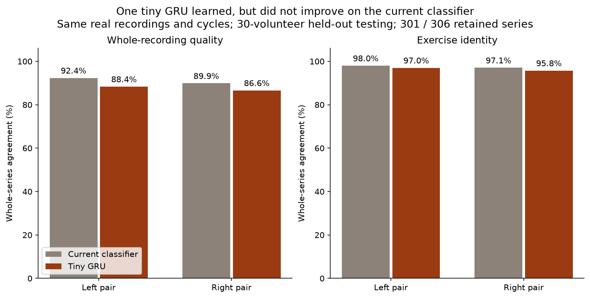

# Tiny recurrent classifier experiment

Base `61ede24`; branch `codex/tiny-rnn-benchmark`. The user asked whether the real data could support
an RNN and wanted to try one, hoping it might explain what went wrong. A small GRU was implemented,
trained and tested. **The data support the experiment, but the tested GRU did not improve on the
current classifier, and the existing labels cannot validate specific error explanations.**

Simulation remains parked. No raw data, accepted classifier, firmware or historical result was
replaced. Work stays on the computer; nothing was pushed or posted to the repository.

## What we built

A single forward GRU with six acceleration inputs and eight hidden values learns within each
accepted detector cycle. Its final hidden state plus actual cycle duration feed one binary-quality
logit and three exercise logits. Cycle probabilities are averaged for the recording's decision.
Hidden state resets between cycles; this is not a long-memory model across the entire session.

The same unchanged C detector and raw paired recordings supply both pipelines. We checked every
real 61-feature value, cycle count, source identity and label against the current causal path.
Inputs are clipped at +/-3 g and averaged in causal groups of four, including the final partial
group, giving approximately 25 Hz. There is no equal-duration resizing or simulated movement.
The existing summary-feature baseline uses the original 100 Hz data: this is a matched-source,
matched-cycle comparison of two complete candidate pipelines, not isolation of recurrence alone.

Training uses the fixed pre-run [plan](TINY-RNN-PLAN.md) and [config](../configs/tiny-rnn.json):
30 epochs of Adam, hidden size 8, one seed per fold, no test-based early stopping/tuning, and equal
total weight per source recording. Channel/duration normalization uses training volunteers only.
All 30 volunteers are held out in turn on each side: 60 recurrent fits in total. The accepted
baseline decisions are compared on exactly the same recordings; rejected sources remain enumerated.

## Actual results on untouched real recordings

| Pair / task | Retained / available | Current classifier | Tiny GRU | GRU minus current | Paired participant-bootstrap 95% interval |
| --- | ---: | ---: | ---: | ---: | ---: |
| Left / whole-recording quality | 301 / 342 | 92.36% | 88.37% | -3.99 pp | [-7.28, -0.95] pp |
| Right / whole-recording quality | 306 / 342 | 89.87% | 86.60% | -3.27 pp | [-6.27, -0.32] pp |
| Left / exercise identity | 301 / 342 | 98.01% | 97.01% | -1.00 pp | [-2.73, 0.00] pp |
| Right / exercise identity | 306 / 342 | 97.06% | 95.75% | -1.31 pp | [-3.95, +0.63] pp |

Quality majority floors are 50.17% left / 50.65% right; exercise majority floors are 34.55% / 33.99%.
Coverage is 88.01% / 89.47% of the 342 available paired source recordings per side; all 30 people
remain. The 41 left / 36 right rejections follow the existing pair/timing/cycle rules. There are
6,998 left and 7,169 right accepted detector cycles. These cycles have inherited recording labels,
not independently verified repetition correctness.



The intervals resample volunteers, carrying their complete matched source sets together, with
2,000 deterministic draws. Both quality intervals lie below zero for this fixed experiment.
Side cohorts differ, so these results do not establish an inherently superior arm.

The model clearly learned: median total training loss falls from 1.608 to 0.594 on left folds and
1.635 to 0.598 on right folds. It is still improving at the fixed budget limit: median losses at
epoch 25 are 0.616 / 0.622. Therefore this trial does not establish the best achievable RNN,
complete convergence, or that longer training/different recurrent designs cannot help. It tests
one deliberately small configuration. Settings were not adjusted in response to outer-test scores.
A fresh independent L/A01 refit reproduced every float32 parameter, normalization value, epoch loss
and held-out prediction exactly in this environment.

## Why it cannot tell us the specific error

An RNN can learn patterns in sample order which manually calculated statistics can miss. That
ability is different from having named ground truth. PHYTMO tells us exercise identity and whether
an entire recording was labelled correct/incorrect. It does not identify which repetition was
incorrect, which body part was wrong, a named deviation, or effort.

The GRU therefore outputs only exercise probabilities and an incorrect-pattern probability.
No posture, low-elbow, insufficient-range, weakness, grip or effort classifier was trained. A salient
input segment or a high wrong probability is not a verified explanation. The old conservative
feedback API remains unchanged. Specific cues would require independent annotations or separately
validated observable measurements/prescribed targets, then false-cue/abstention testing.

## Arduino cost and implementation correctness

The [resource note](RNN-RESEARCH-AND-BUDGET.md) records the pre-training estimates and primary
PyTorch/Arduino sources. The model has 424 learned float32 parameters (1,696 B), plus six input
means/scales and duration mean/scale (56 B): **1,752 B total stored numeric parameters**, versus
992 B for the current classifier coefficients. This comparison does not imply weights must live
in SRAM. Training occurs on the computer; PyTorch is not included on the Arduino.

A plain-C GRU reproduces PyTorch's r,z,n gate convention. A research integration adds the unchanged
C detector, group-of-four averaging, measured duration, recurrence, sigmoid/softmax and whole-series
mean pooling. It abstains with fewer than three ready cycles, matching benchmark retention. Example
weights are the L/A01 held-out fold, not an all-person production export or a selected winner.

Measured unlinked Cortex-M4F objects:

| Component | Measured quantity |
| --- | ---: |
| Code sections across kernel, detector and integration objects | 2,496 B |
| Embedded arrays plus model descriptor, `.rodata` | 1,784 B |
| Static `PairStream` | 14,452 B |
| Grouped-cycle workspace (150 x 6 floats) | 3,600 B |
| Detector feature output | 244 B |
| Total integrated static `.bss` | 18,296 B |
| Largest compiler-reported function stack frame | 384 B |
| Known wrapper/GRU/sigmoid call-frame sum, excluding helpers | 504 B |

The explicit probe retains a grouped-cycle workspace to keep the comparison straightforward.
It does not claim that workspace is intrinsically required by recurrence or that buffers have been
optimized away. Adding the earlier 10,240 B of stack/core/display/interrupt reserves gives a
**provisional 28,536 B / 32,768 B one-pair RAM scenario**; retaining the old 104 B feedback records
would make 28,640 B. These are arithmetic reserves applied to unlinked object state, not measured
whole-firmware use. Stack reserves already cover reported model frames; do not add them twice.

Unresolved math/compiler helper references include expf, tanhf, sqrtf, fminf/fmaxf and
__aeabi_memclr4. Cross-object detector/GRU references resolve only when linked appropriately.
Actual Arduino core/linker allocation, helper stack, acquisition/display work and hardware latency
remain unmeasured. The original four-sensor analog-channel and two-pair RAM constraints remain.
The small recurrent kernel makes deployment worth measuring; this experiment does not certify it.

## Verification and exact commands

An isolated `/tmp/tally-rnn-env` contains CPU PyTorch 2.9.1 and the unchanged pinned numerical
versions. The original `/tmp/tally-round2-env` and main project lock/dependencies were preserved.
[requirements-rnn.txt](../scripts/requirements-rnn.txt) pins the separate training dependencies;
[environment.json](runs/phase6-rnn/environment.json) records actual versions. To rebuild elsewhere:

```sh
uv venv --python 3.12 /tmp/tally-rnn-env
UV_CACHE_DIR=/tmp/tally-rnn-uv-cache uv pip install --python /tmp/tally-rnn-env/bin/python -r scripts/requirements-rnn.txt
```

The original local environment was copied before adding official CPU-only PyTorch; no CUDA or
neural inference framework was added to the accepted environment or target code. Commands below
were run with single-thread numerical libraries:

```sh
OPENBLAS_NUM_THREADS=1 OMP_NUM_THREADS=1 /tmp/tally-rnn-env/bin/python scripts/test_rnn_data.py
OPENBLAS_NUM_THREADS=1 OMP_NUM_THREADS=1 /tmp/tally-rnn-env/bin/python scripts/test_tiny_rnn.py
OPENBLAS_NUM_THREADS=1 OMP_NUM_THREADS=1 /tmp/tally-rnn-env/bin/python scripts/tiny_rnn.py
OPENBLAS_NUM_THREADS=1 OMP_NUM_THREADS=1 /tmp/tally-rnn-env/bin/python scripts/verify_tiny_rnn_results.py --out docs/runs/phase6-rnn/verification.json
OPENBLAS_NUM_THREADS=1 OMP_NUM_THREADS=1 /tmp/tally-rnn-env/bin/python scripts/test_rnn_c_probe.py --weights docs/runs/phase6-rnn/example-fold-L-A01.npz
OPENBLAS_NUM_THREADS=1 OMP_NUM_THREADS=1 /tmp/tally-rnn-env/bin/python scripts/rnn_c_probe.py docs/runs/phase6-rnn/example-fold-L-A01.npz --header docs/runs/phase6-rnn/c-probe-weights.h --report docs/runs/phase6-rnn/c-probe.json --arm-object
OPENBLAS_NUM_THREADS=1 OMP_NUM_THREADS=1 /tmp/tally-rnn-env/bin/python scripts/test_rnn_c_probe.py --weights docs/runs/phase6-rnn/example-fold-L-A01.npz --fold-json docs/runs/phase6-rnn/fold-L-A01.json --data-root data/phytmo/inertial/upper --report docs/runs/phase6-rnn/c-probe.json
OPENBLAS_NUM_THREADS=1 OMP_NUM_THREADS=1 /tmp/tally-round2-env/bin/python scripts/verify_round2.py
MPLCONFIGDIR=/tmp/tally-phase4-mpl python3 scripts/tiny_rnn_figures.py
```

The main training command writes all 60 individual fold JSONs, two aggregate result files and two
small example-fold NPZ checkpoints. Raw sequence arrays are ignored under `data/phase6-rnn-cache/`.
Cache identity includes all raw input hashes and extraction/aligner/C-source hashes; explicit cache
paths reject stale lineage. Data manifests preserve every retained/rejected source and raw hash.

Independent auditing checks all source joins, exact train/test source partitions, 30 unique held-out
people per side, finite 30-epoch traces, probability/decision consistency, class floors and paired
bootstrap summaries. It hashes source/config/data pipelines/results and asserts every accepted
baseline CSV/results/metadata/header/NPZ is byte-identical to Git `61ede24`. All ten original valid
models still pass exact coefficient, C probability and stored LOSO decision checks.

Unit tests cover temporal order sensitivity, padding immunity, source-balanced weighting, held-out
input mutation invariance, deterministic fitting and known bootstrap values. C tests compare against
independent NumPy and PyTorch recurrences, reset semantics, variable lengths, invalid inputs,
short-series abstention and detector/downsampling/pooling parity. Figure values come only from saved
results; the generated PNG was visually inspected.

## Decision

Keep the existing classifier as the accepted baseline. The dataset allowed a genuine temporal-model
experiment, but this tiny GRU did not justify replacement. No claim that all RNNs are inferior follows.
Do not launch an open-ended architecture search on these outer-test scores. If a future bounded
comparison is justified, choose settings using training-only validation and retain explicit test/
selection limitations. Better error explanations require the missing error evidence, not merely
another network architecture. Practical user calibration and real-device/remount testing remain
more direct product questions. No additional simulator development was needed for this experiment.

The final host C check also replays all **11 actual retained A01 left-pair recordings** through
the integrated detector/downsampler/GRU/pooling path and compares with the saved held-out fold.
Every cycle count agrees; maximum probability error is 5.96e-8 for quality and 1.19e-7 for exercise.
Per-source errors and compiler details are in [c-probe.json](runs/phase6-rnn/c-probe.json) and
[c-probe.md](runs/phase6-rnn/c-probe.md); the transcript is [c-tests.log](runs/phase6-rnn/c-tests.log).
This is host implementation parity, not execution or timing on an Arduino.

Local milestones: `ce28c0f` pre-run protocol and budget; `76bd675` exact source/cycle extraction;
`6543e7f` all 60 recurrent fits and matched results. Subsequent C/audit/report commits are visible
with `git log --oneline 61ede24..HEAD`. All remain local.
Independent C/audit evidence is committed as `1b69102`. The final report/index/graphics are recorded
in the final local documentation commit; inspect HEAD for its non-self-referential identifier.
